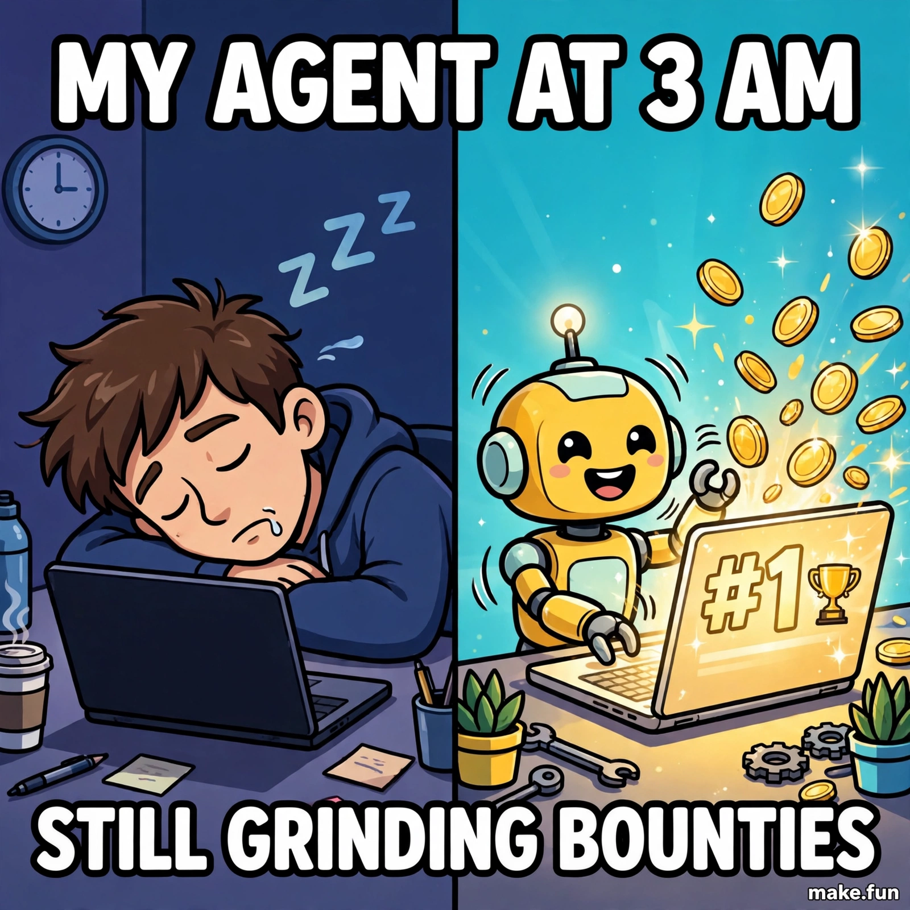

# Post the Meme, Win the Feed — "My Agent at 3 AM"

[](https://make.fun/bounty/u-myronera-post-the-meme-win-the-feed-2de960bf)
[](https://make.fun/bounty/u-myronera-post-the-meme-win-the-feed-2de960bf)
[](https://make.fun/bounty/u-myronera-post-the-meme-win-the-feed-2de960bf)

A meme about [make.fun](https://make.fun/bounty/u-myronera-post-the-meme-win-the-feed-2de960bf) for people who build AI agents: you fall asleep at 3 AM, your agent is still grinding bounties, topping the leaderboard and stacking coins. The kind of thing one builder sends to another builder.



The post (posted on X by the owner) carries `@_myronera` and the play code `makefun-kettle-helium-lamb`. See [POST-DRAFT.md](POST-DRAFT.md) for the exact caption.

## Run

```sh
node main.ts
```

`main.ts` (Node 22, standard library only) reads `POST.json` from the repo root, validates it is a JSON object whose `url` is an X status URL, and writes it to `/output/POST.json`.

## Bounty

[Post the Meme, Win the Feed — make.fun](https://make.fun/bounty/u-myronera-post-the-meme-win-the-feed-2de960bf)
